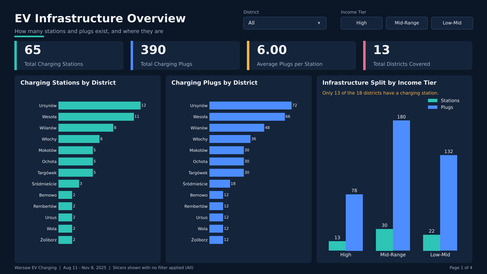
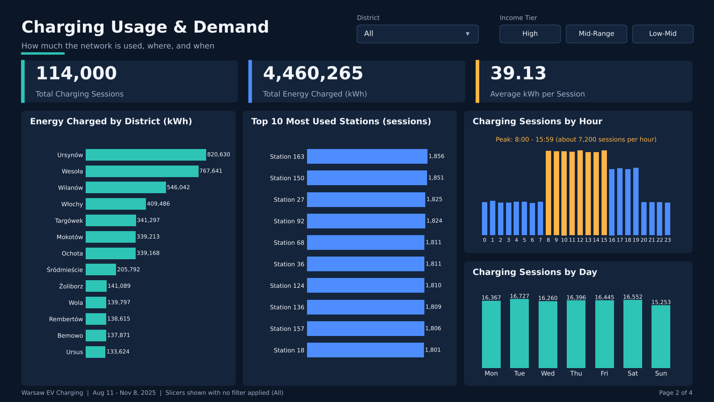
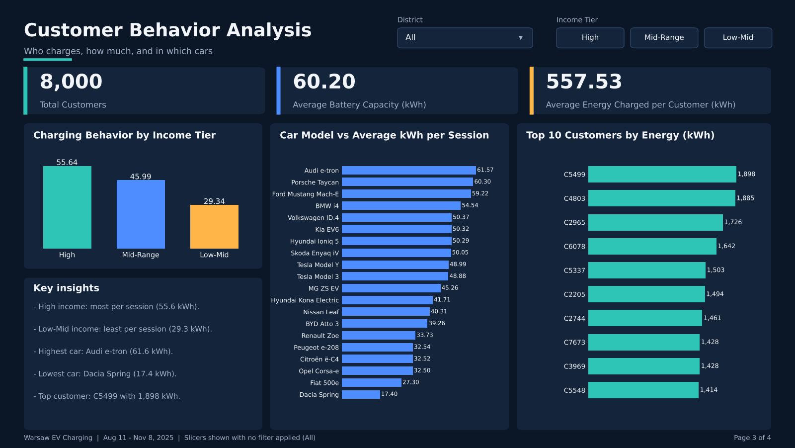
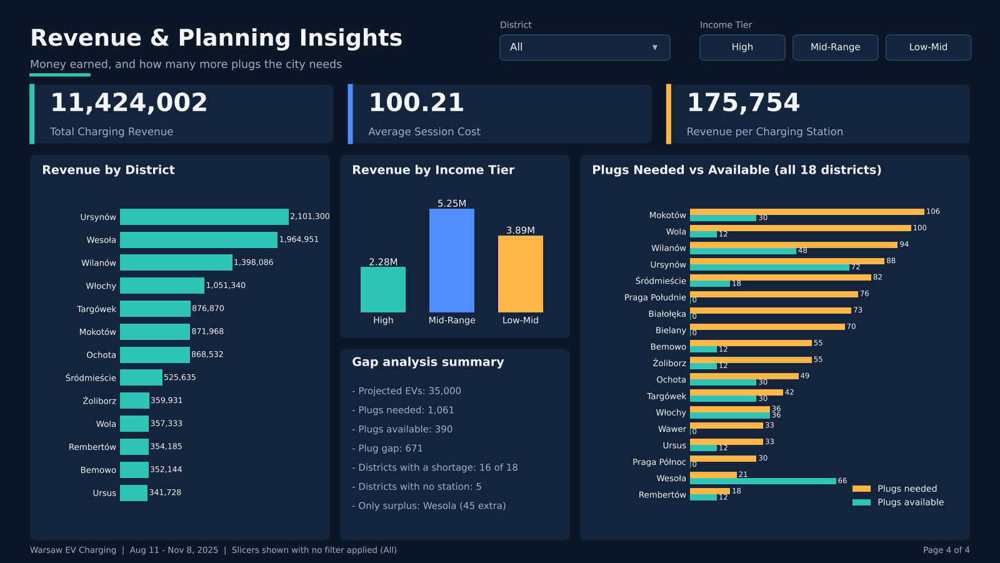

# Warsaw EV Charging — Machine Learning Model

An end-to-end, reproducible machine-learning pipeline for predicting the **energy delivered by a single EV charging session** in Warsaw, using the available transaction, customer, station and district data.

The project includes reusable preprocessing code, a leakage-safe chronological evaluation, a saved scikit-learn pipeline, a batch prediction script, unit tests, and actual Markdown/HTML evaluation reports.

> **Project status: Completed — v1.0.0 (2026-10-20).**
>
> The final model has been trained, the chronological holdout has been evaluated, 14 tests pass, and all reports (model evaluation plus SQL/visual insights) are generated. This tag marks the reproducible baseline and is not a claim of production readiness.

## Headline results

These values are from the actual executed pipeline in this repository, evaluated on a chronological holdout that was not used for model selection:

| Item | Result |
|---|---:|
| Selected model | Ridge Regression (alpha = 0.1) |
| Test sessions | 17,674 |
| Test MAE | **4.518 kWh** |
| Test RMSE | **5.426 kWh** |
| Test R² | **0.8187** |
| Test MAPE | **11.89%** |
| Dummy mean baseline RMSE | 12.746 kWh |
| Station-day conditional aggregation MAPE | 2.59% |

Selected model versus the dummy baseline: **57.4% lower RMSE** and **56.2% lower MAE**.

Important caveat: a transparent one-feature benchmark (`0.65 × battery capacity`) is statistically indistinguishable from the ML model. The current feature set adds no measurable accuracy beyond vehicle battery capacity. The model is therefore a useful planning prototype, not evidence of a production-grade operational forecasting system.

## Dashboard preview

A four-page Power BI report built on the same dataset. Full-resolution exports are in `docs/dashboard/`.



| Usage and demand | Customer behaviour |
|---|---|
|  |  |



## Prediction task

- **Target:** `kwh_charged` — delivered energy in one charging session.
- **Unit:** kWh.
- **Task:** supervised regression.
- **Prediction time:** when the customer/vehicle, station, tariff and session start time are known.
- **Features:** battery capacity, vehicle model, customer tier, station operator/coordinates/tier, district planning attributes, tariff, and cyclical time features.
- **Excluded:** `total_cost` (target-derived), `session_id`, `customer_id`, `station_id`, raw timestamp.
- **Split:** chronological by whole calendar days; test is strictly after validation.

The chosen target is directly observed at transaction level and supports capacity/energy planning. Session duration is unavailable in the source data; revenue is a deterministic function of energy and tariff; station utilization and arrival forecasting require data that are not present.

## Dataset

The pipeline expects four CSVs in one directory:

| File | Rows | Role |
|---|---:|---|
| `charging_sessions.csv` | 114,000 | Session target, timestamp, tariff |
| `charging_stations.csv` | 65 | District, operator, location |
| `customers.csv` | 8,000 | Vehicle and customer segment |
| `districts.csv` | 18 | Static district planning projections |

Actual inspected window: **2025-08-11 to 2025-11-08** (89 days). After removing 4 contradictory repeated customer/start-minute sessions, **113,996** sessions entered modeling.

The source CSVs are read in place and are never modified or copied into the repository.

### Data-quality note

The target is almost perfectly bounded between **50% and 80% of battery capacity**, with every vehicle model showing a mean ratio near 0.65. This is characteristic of a simulated or highly standardized process. The high R² primarily reflects vehicle battery size, not operational behavior. Real-world use requires validation on actual charging-network data with state-of-charge, duration, occupancy, weather and traffic information.

## Modeling approach

1. Validate schemas and parse timestamps/numeric fields.
2. Remove exact duplicates, duplicate session IDs, impossible timestamps, missing identifiers and non-positive targets.
3. Join customer, station and district tables with many-to-one checks.
4. Engineer calendar and district features; explicitly exclude target-derived fields and identifiers.
5. Split **chronologically by day** into train (62 days), validation (14 days) and test (14 days).
6. Compare Dummy mean, Ridge, Random Forest and HistGradientBoosting with a small fixed hyperparameter grid. A battery-capacity heuristic is reported as a domain reference.
7. Select by **validation RMSE** (tie-break MAE and complexity). Refit the selected pipeline on train + validation.
8. Evaluate **once** on the test period; compute MAE, RMSE, R², MAPE, bootstrap intervals, residuals, segment errors, permutation importance and conditional station-day aggregation.
9. Save the fitted pipeline, preprocessing, metadata, data fingerprint and reports.

All imputers, encoders, scalers and estimators live inside the saved scikit-learn `Pipeline`. They are fitted only on training data (or train + validation for the final refit), never on test data.

## Project structure

```text
.
├── configs/
│   └── config.example.json
├── models/
│   ├── best_model.joblib          # final selected pipeline (7 KB, committed)
│   └── model_metadata.json        # generated metadata
├── reports/
│   ├── model_evaluation_report.md
│   ├── model_evaluation_report.html   # self-contained offline HTML
│   ├── model_metrics.json
│   ├── insights_report.md             # SQL/visual insights and recommendations
│   ├── insights_report.html           # self-contained offline HTML
│   ├── insights_metrics.json
│   ├── feature_importance.csv
│   ├── segment_metrics_*.csv
│   └── figures/*.png                  # model diagnostics + insights_*.png
├── docs/
│   └── dashboard/page-*.png           # four-page Power BI dashboard exports
├── sql/
│   ├── warsaw_ev_analysis.sql         # 14 MySQL queries
│   └── query_outputs.txt              # executed query results
├── src/
│   ├── config.py
│   ├── data_loader.py
│   ├── preprocessing.py
│   ├── metrics.py
│   ├── train.py
│   ├── evaluate.py
│   ├── reporting.py
│   ├── insights.py
│   └── predict.py
├── tests/
│   ├── conftest.py
│   ├── test_preprocessing.py
│   ├── test_training.py
│   ├── test_reporting.py
│   └── test_insights.py
├── requirements.txt
└── README.md
```

## Setup (Windows PowerShell)

Tested with Python **3.14.6**, scikit-learn **1.9.1**, pandas **3.0.6**, numpy **2.5.4** and matplotlib **3.11.2**.

```powershell
py -m venv .venv
.\.venv\Scripts\Activate.ps1
python -m pip install --upgrade pip
python -m pip install -r requirements.txt
```

## Configuration

The dataset directory is never hard-coded with a username. Resolution order:

1. `--data-dir` command-line argument
2. `WARSAW_EV_DATA_DIR` environment variable
3. `configs/config.json`
4. Default: `%USERPROFILE%\Downloads\OneDrive_2026-10-14\Warsaw EV Charging`

Output directories default to `models/` and `reports/` and can be changed with `--model-dir`, `--reports-dir`, `WARSAW_EV_MODEL_DIR` / `WARSAW_EV_REPORTS_DIR`, or the JSON config. See `configs/config.example.json`.

Example using the environment variable:

```powershell
$env:WARSAW_EV_DATA_DIR = "C:\Users\<you>\Downloads\OneDrive_2026-10-14\Warsaw EV Charging"
```

Or pass it explicitly:

```powershell
python -m src.train --data-dir "C:\path\to\Warsaw EV Charging"
```

## Run the pipeline

```powershell
# 1. Train and select the model; writes models/best_model.joblib and metadata
python -m src.train --data-dir "C:\path\to\Warsaw EV Charging"

# 2. Evaluate once on the chronological test set; regenerates metrics, figures and reports
python -m src.evaluate --data-dir "C:\path\to\Warsaw EV Charging"

# 3. Build the SQL/visual insights report and its six charts
python -m src.insights --data-dir "C:\path\to\Warsaw EV Charging"
```

The evaluation report is written to:

- `reports/model_evaluation_report.md`
- `reports/model_evaluation_report.html` (open in any browser; images are embedded and no internet is required)

The insights report is written to:

- `reports/insights_report.md`
- `reports/insights_report.html` (self-contained; six embedded charts, no internet required)
- `reports/insights_metrics.json` and `reports/figures/insights_*.png`

The trained pipeline is saved at `models/best_model.joblib`; metadata is at `models/model_metadata.json`.

## Predict new sessions

Input CSV must contain:

| Column | Required | Notes |
|---|---|---|
| `customer_id` | yes | Must exist in `customers.csv` |
| `station_id` | yes | Must exist in `charging_stations.csv` |
| `session_start_time` | yes | Parsed as datetime |
| `cost_per_kwh` | yes | Positive tariff |
| `session_id` | no | Generated row ID if absent |
| `kwh_charged` | no | Optional actual value for post-hoc scoring; never used by the model |

```powershell
python -m src.predict `
  --input new_sessions.csv `
  --data-dir "C:\path\to\Warsaw EV Charging" `
  --output reports/new_predictions.csv
```

Output includes `predicted_kwh`, `predicted_total_cost` (predicted kWh × supplied tariff), model label and target unit. Unknown customer/station IDs raise a clear error rather than silently imputing a different entity.

## Tests

```powershell
python -m pytest -q
```

Verified in this environment: **14 tests passed**. Tests cover schema validation, duplicate/invalid-record cleaning, target leakage guards, chronological split integrity, preprocessing fit/transform, unknown categories, metric calculations, model save/load, prediction invariance to the target column, inference joins, Markdown/HTML report generation with offline image embedding, and the SQL/visual insights generator.

Small synthetic data are used only for unit tests; all reported metrics come from the real configured dataset.

## Reproducibility and leakage controls

- Fixed random seed: 42.
- Chronological split by whole dates; no shuffling.
- Validation used for model selection; test evaluated once afterwards.
- Final model refit on train + validation only.
- Data fingerprint checked before evaluation; changing source CSVs requires retraining (or explicit `--allow-data-change` for a new experiment).
- Artifacts include the fitted preprocessing pipeline and feature list.
- Source files are not modified.
- The small final Ridge artifact is committed for reproducible inference; row-level test predictions are gitignored.

Current dataset fingerprint:

```text
2a5e090ba972d96c66865353df5977a6bd7b485aa4428d6914e3304f633bfe9c
```

## Actual evaluation highlights

- Validation selected Ridge Regression (alpha = 0.1): RMSE **5.453 kWh**, MAE **4.537 kWh**, R² **0.8164**.
- Held-out test: MAE **4.518 kWh**, RMSE **5.426 kWh**, R² **0.8187**, MAPE **11.89%**.
- Bootstrap 95% CI for test RMSE: approximately **5.377–5.474 kWh**.
- Dummy baseline test RMSE: **12.746 kWh**; RMSE reduction **57.4%**.
- Battery-capacity heuristic test RMSE: **5.426 kWh**; effectively tied with the ML model.
- Conditional station-day aggregation: MAE **19.2 kWh**, MAPE **2.59%** across 910 station-days. This assumes the future session mix is known; it is not an arrival forecast.
- Top permutation importance: `battery_capacity_kwh` (9.75 kWh RMSE increase), then customer income tier and vehicle model (correlated with capacity); all time/station/district features are near zero.

## SQL and visual insights report

`reports/insights_report.md` / `.html` answer the capstone's airline-style brief ("reduce delays, optimize operations, enhance customer experience") with the actual Warsaw EV evidence: 14 SQL queries executed against MySQL 8.0.46, six charts generated directly from the 114,000-session source, and the verified ML metrics above. The report opens with a mapping table that translates each airline clause into its EV equivalent and is explicit that no airline data is present.

Headline insights:

- **Coverage, not station productivity, is the constraint.** 13 of 18 districts have stations; the five unserved districts hold 9,300 projected EVs and 282 planned plugs. Built coverage is 390 / 1,061 planned plugs = 36.8%; Wola is the worst served district at 12% coverage and 275 projected EVs per plug.
- **Demand is flat and business-hours driven.** About 1,267 sessions/day with no growth trend; 50.4% of sessions start between 08:00 and 15:59 versus 29.7% overnight (2.47%/hour). Day-of-week variation is under 10%.
- **Stations are uniform.** The busiest station is only 1.06x the network average, so there is no station-level hotspot to relieve.
- **Pricing is effectively uniform across districts and tiers** (district averages span 2.551–2.572 PLN/kWh; three session-level tariff points are applied network-wide). Revenue rank equals volume rank.
- **The income gap is a vehicle gap.** High-tier customers spend 1.89x Low-Mid per session, but sessions per customer and average price per kWh are identical; kWh per session tracks battery capacity (85.6 vs 45.2 kWh).
- Recommendations are planning and instrumentation actions: close the five-district gap (Praga Południe first), remediate Wola, use ratio-based planning KPIs, manage the 08:00–15:59 peak, and instrument occupancy, queues and state-of-charge before promising wait-time or experience improvements.

Regenerate with `python -m src.insights`; the metrics behind the report are in `reports/insights_metrics.json`.

The standalone SQL work is also committed:

- `sql/warsaw_ev_analysis.sql` — 14 MySQL queries covering district coverage, station usage, energy, revenue, customer tiers and planned plug gaps.
- `sql/query_outputs.txt` — the executed results behind the insights above.

## Limitations and recommended next steps

- The dataset appears synthetic or highly standardized; do not treat these scores as production accuracy.
- Only 89 days in one city/season; no rolling-origin backtest yet.
- No session duration, arrival/departure state of charge, charging power, queue, occupancy, weather, traffic or event data.
- One chronological holdout; bootstrap intervals describe metric uncertainty, not individual-session uncertainty.
- Not suitable for real-time control, customer pricing guarantees, revenue/ROI claims or expansion decisions.
- Next data investments: state of charge, duration, occupancy/queues, weather/traffic/events, longer history, and a separate arrival-count model for genuine demand forecasting.
- Next modeling steps: quantile/conformal intervals, rolling-origin validation, grouped-by-customer sensitivity analysis and production drift monitoring.

## Reports and artifacts

- Markdown: `reports/model_evaluation_report.md`
- HTML: `reports/model_evaluation_report.html`
- Metrics JSON: `reports/model_metrics.json`
- Insights report: `reports/insights_report.md` / `reports/insights_report.html`
- Insights metrics: `reports/insights_metrics.json`
- Feature importance: `reports/feature_importance.csv`
- Figures: `reports/figures/`
- Power BI dashboard exports: `docs/dashboard/`
- SQL queries and outputs: `sql/`
- Model: `models/best_model.joblib`
- Metadata: `models/model_metadata.json`

The report distinguishes actual executed results from methodological explanation and recommendations. No metric or chart is hand-entered.
