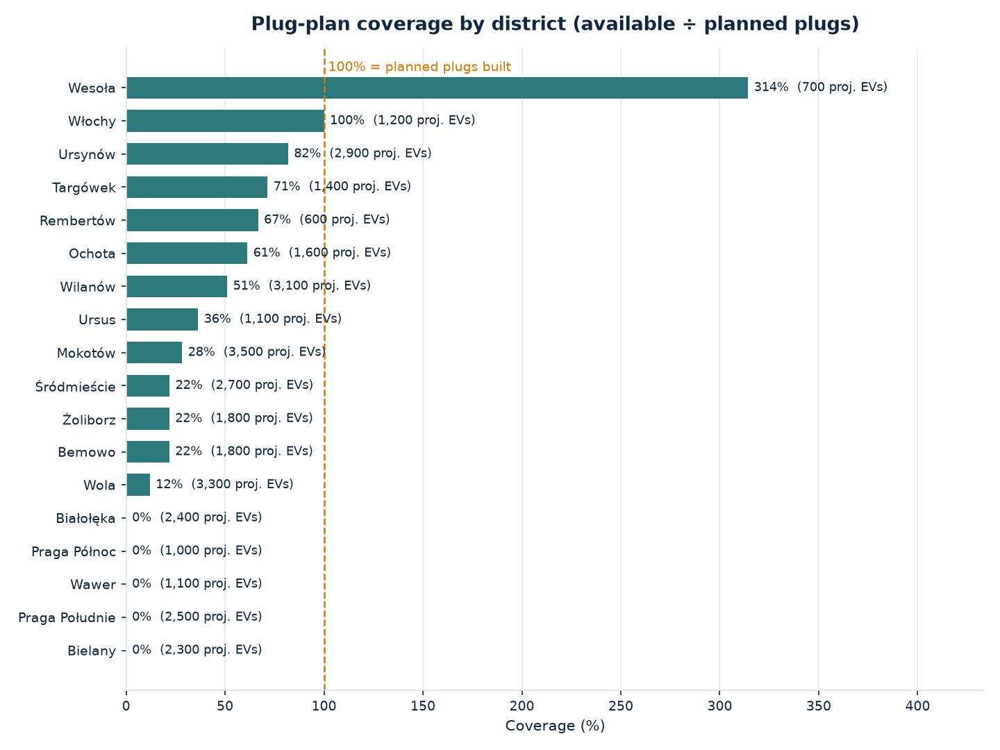
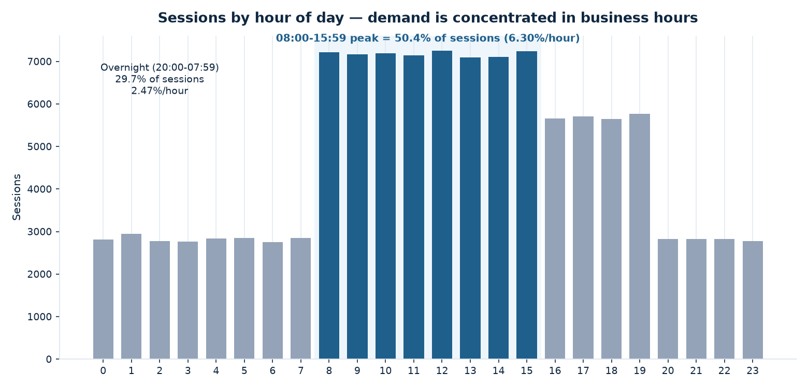
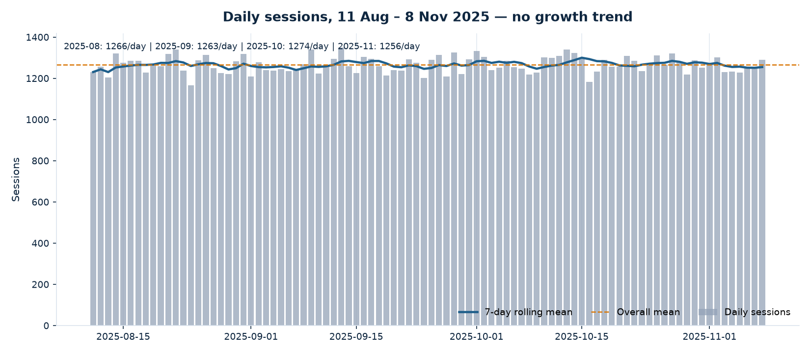
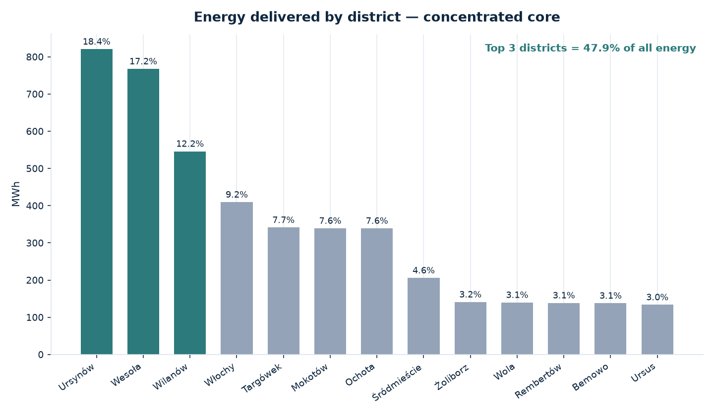
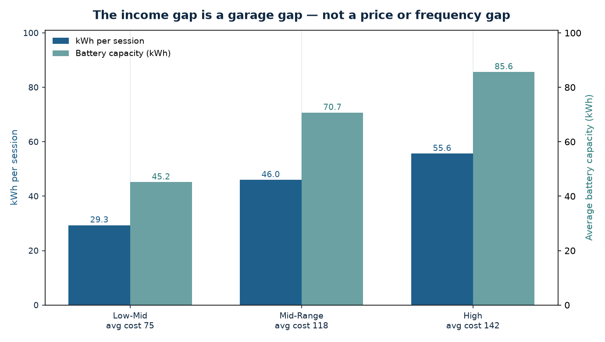
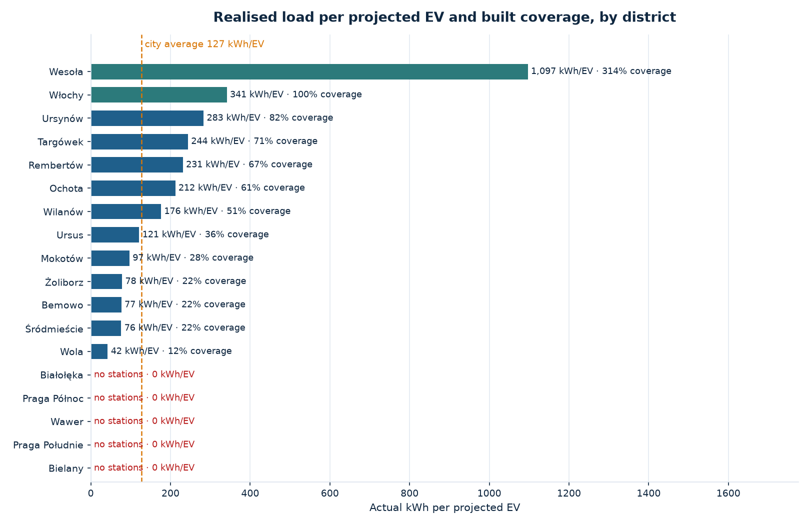

# Warsaw EV Charging — Insights & Recommendations Report

**Generated:** 2026-10-19T18:58:23+00:00  |  **Data window:** 2025-08-11 to 2025-11-08  |  **Sessions:** 114,000  |  **Fingerprint:** `2a5e090ba972d96c66865353df5977a6bd7b485aa4428d6914e3304f633bfe9c`

> **Airline wording notice.** The assignment template says 'airlines reduce delays, optimize operations, enhance customer experience'. The dataset is Warsaw EV charging; Section 1 maps each airline clause to its EV equivalent. All findings below are based on the executed SQL analysis and the source data. No airline-specific figure is invented.

## Contents

- [1. Scope and airline-equivalent mapping](#1-scope-and-airline-equivalent-mapping)
- [2. Executive summary](#2-executive-summary)
- [3. Evidence base and method](#3-evidence-base-and-method)
- [4. Finding 1: coverage is concentrated in a dense core](#4-finding-1-coverage-is-concentrated-in-a-dense-core)
- [5. Finding 2: demand is flat and business-hours driven](#5-finding-2-demand-is-flat-and-business-hours-driven)
- [6. Finding 3: revenue is a pure volume business](#6-finding-3-revenue-is-a-pure-volume-business)
- [7. Finding 4: the income gap is a vehicle gap, not a pricing gap](#7-finding-4-the-income-gap-is-a-vehicle-gap-not-a-pricing-gap)
- [8. Finding 5: absolute shortfalls cannot prioritise, but ratios can](#8-finding-5-absolute-shortfalls-cannot-prioritise-but-ratios-can)
- [9. Finding 6: operations are uniform at station level](#9-finding-6-operations-are-uniform-at-station-level)
- [10. Finding 7: the predictive model is an energy estimator, not a demand forecast](#10-finding-7-the-predictive-model-is-an-energy-estimator-not-a-demand-forecast)
- [11. Data quality and interpretation limits](#11-data-quality-and-interpretation-limits)
- [12. Actionable recommendations](#12-actionable-recommendations)
- [13. Conclusion](#13-conclusion)
- [14. Appendix](#14-appendix)

## 1. Scope and airline-equivalent mapping

> **Assignment wording note**
>
> The brief uses airline language: reduce delays, optimize operations, enhance customer experience. The dataset and executed SQL analysis are for Warsaw EV charging. No airline data is present here, so this report maps each airline clause to its EV equivalent and keeps every number evidence-based. Airline-specific figures are not invented.

**How the airline wording is answered**

| Airline brief clause | EV-equivalent interpretation | Evidence base |
| --- | --- | --- |
| Reduce delays | Reduce access gaps and peak-time congestion; shorten the distance and wait between demand and available infrastructure. | Q2, Q3, Q7, Q11, Q13; hourly and coverage figures |
| Optimize operations | Prioritise district-level siting, load management, operator performance and capacity sequencing instead of station-level add-ons. | Q2-Q8, Q11-Q14; district, station and operator tables |
| Enhance customer experience | Improve coverage, availability, transparent flat pricing and off-peak options; instrument waits, occupancy and state-of-charge to measure experience directly. | Q4, Q5, Q9, Q10; customer and usage tables |

The report has three evidence layers: (1) 14 SQL queries executed against MySQL 8.0.46 and reproduced in `part1_sql_analysis.md`; (2) a Power BI build specification with four pages and 24 visuals (`part2_powerbi_build_spec.md`); and (3) the session-energy ML model and its chronological holdout evaluation in this repository. The six figures in this report were generated directly from the same 114,000-session source CSVs so the SQL findings are visible in one place.

## 2. Executive summary

> **What the evidence says**
>
> 114,000 sessions delivered 4,460,265 kWh and 11,424,002 PLN over 90 days. The network is dense in a few districts and empty in five. Demand is stable and concentrated in business hours, individual stations are remarkably uniform, and the tariff is flat. The main growth levers are coverage and utilisation, not pricing.

- **Coverage is the largest gap.** Only 13 of 18 districts have a station; the five unserved districts hold 9,300 projected EVs (26.6% of the city plan) and 282 planned plugs.
- **Built coverage is 36.8%.** 390 of 1,061 planned plugs exist. Wola is the worst served district at 12.0% coverage and 275 projected EVs per plug.
- **Demand is flat, not growing.** The network averages 1267 sessions/day; the strongest month was 2025-10 at 1274/day and the weakest was 2025-11 at 1256/day.
- **Demand is a business-hours phenomenon.** 50.4% of sessions start between 08:00 and 15:59 (6.30%/hour) versus 29.7% overnight (2.47%/hour).
- **There is no station hotspot.** The busiest station has only 1.06× the network average (1,856 vs 1754 sessions).
- **Price is not a lever.** District average price is effectively uniform at 2.5613 PLN/kWh (0.81% spread between the highest- and lowest-priced districts; operator spread under 1%). District revenue rank is identical to volume rank.
- **The income gap is a vehicle gap.** High-tier customers pay 1.89× Low-Mid per session, but sessions per customer are identical across tiers (about 14.25) and average price per kWh is uniform at 2.5613.
- **The ML model predicts session energy, not arrivals.** It reaches test RMSE 5.426 kWh and R² 0.8187, but a one-feature battery benchmark ties it. Use it for conditional energy planning, not demand forecasting.

## 3. Evidence base and method

### SQL analysis

Fourteen SQL queries were executed against the `warsaw_ev` MySQL 8.0.46 schema. The queries cover district inventory, station and plug counts, session and energy volumes, station utilisation, revenue, customer tiers, customer concentration, projected EV-per-plug ratios, planning shortfalls, demand intensity and a documented readiness rank. Results are reproduced verbatim in `part1_sql_analysis.md` with raw output in `sql/query_outputs.txt`.

**Analysed dataset**

| Evidence item | Value |
| --- | --- |
| Sessions analysed | 114,000 |
| Stations | 65 |
| Customers | 8,000 |
| Districts | 18 |
| Date window | 2025-08-11 to 2025-11-08 (90 days) |
| Energy delivered | 4,460,265 kWh |
| Billed revenue | 11,424,001.70 PLN |
| Mean session | 39.1251 kWh / 100.21 PLN |
| Data fingerprint | `2a5e090ba972d96c66865353df5977a6bd7b485aa4428d6914e3304f633bfe9c` |

### Visualisations

The Power BI specification defines four pages and 24 visuals. The six charts in this report were generated from the same raw CSV rows and follow the SQL definitions: coverage by district, hourly demand, daily trend, district energy concentration, income decomposition and the readiness chart. The ML report in `reports/model_evaluation_report.md` supplies the separate model-diagnostic figures.

### Predictive model

The ML pipeline predicts `kwh_charged` for a known session using vehicle, station, district, tariff and time features. It uses a chronological split, selects on validation RMSE and evaluates the held-out test period once. The model is not an arrival or utilisation forecast; it predicts energy conditional on a session that is already starting.

## 4. Finding 1: coverage is concentrated in a dense core

13 of 18 districts have at least one charging station. Ursynów (12 stations) and Wesoła (11) alone hold 35% of the 65 stations, and the top three districts hold 47.7% of all stations. The five unserved districts — Praga Południe, Białołęka, Bielany, Wawer, Praga Północ — hold 9,300 projected EVs and 282 planned plugs.

**Unserved districts and their planned capacity**

| District (unserved) | Projected EVs | Plugs now | Planned plugs |
| --- | --- | --- | --- |
| Praga Południe | 2,500 | 0 | 76 |
| Białołęka | 2,400 | 0 | 73 |
| Bielany | 2,300 | 0 | 70 |
| Wawer | 1,100 | 0 | 33 |
| Praga Północ | 1,000 | 0 | 30 |

> **Capacity built vs planned**
>
> Across the city, 390 of 1,061 planned plugs are built = 36.76%. The unserved five account for 282 of the unbuilt plans. `plugs_count` is a constant 6 for every station, so plug count is exactly station count × 6 and must not be presented as an independent metric.

*Plug-plan coverage by district: five districts at 0%, Wola at 12%.*

## 5. Finding 2: demand is flat and business-hours driven

The network records 114,000 sessions, 4,460,265 kWh and a mean session of 39.13 kWh (range 13.40–76.00 kWh). The daily rate is stable: 1267 sessions/day overall, with monthly averages between 1256 and 1274.

**Monthly demand — August and November are partial months**

| Month | Sessions | Active days | Sessions per active day |
| --- | --- | --- | --- |
| 2025-08 | 26,581 | 21 | 1265.8 |
| 2025-09 | 37,882 | 30 | 1262.7 |
| 2025-10 | 39,486 | 31 | 1273.7 |
| 2025-11 | 10,051 | 8 | 1256.4 |

Half of all sessions (50.4%) start between 08:00 and 15:59, averaging 6.30% of daily sessions per hour. The overnight window (20:00–07:59) carries 29.7% of sessions, or 2.47%/hour. Weekday variation is narrow: Tuesday 16,727 vs Sunday 15,253 (9.7% spread).

*Sessions by hour: half of all sessions start in the 08:00-15:59 window.*

*Daily sessions: stable demand around 1,267 sessions per day with no growth trend.*

> **Operational implication**
>
> The recoverable operational lever is time of day, not day of week. Off-peak incentives and managed charging can address the 08:00–15:59 peak; day-of-week pricing would act on a spread of less than 10% and is unlikely to be worth the complexity.

## 6. Finding 3: revenue is a pure volume business

Total billed revenue is 11,424,001.70 PLN, an average of 100.21 PLN per session and 175,754 PLN per station. District revenue rank is identical to session and energy rank because district average price is effectively uniform (0.81% spread). The top three districts account for 47.9% of energy and 47.8% of revenue.

**District revenue follows volume exactly**

| District | Sessions | kWh | Revenue (PLN) | Energy share |
| --- | --- | --- | --- | --- |
| Ursynów | 20,956 | 820,630 | 2,101,300 | 18.4% |
| Wesoła | 19,606 | 767,641 | 1,964,951 | 17.2% |
| Wilanów | 13,956 | 546,042 | 1,398,086 | 12.2% |
| Włochy | 10,447 | 409,486 | 1,051,340 | 9.2% |
| Targówek | 8,746 | 341,297 | 876,870 | 7.7% |
| Mokotów | 8,655 | 339,213 | 871,968 | 7.6% |
| Ochota | 8,696 | 339,168 | 868,532 | 7.6% |
| Śródmieście | 5,259 | 205,792 | 525,635 | 4.6% |
| Żoliborz | 3,595 | 141,089 | 359,931 | 3.2% |
| Wola | 3,569 | 139,797 | 357,333 | 3.1% |
| Rembertów | 3,565 | 138,615 | 354,185 | 3.1% |
| Bemowo | 3,530 | 137,871 | 352,144 | 3.1% |
| Ursus | 3,420 | 133,624 | 341,728 | 3.0% |

**Three tariff points, no district variation**

| Tariff (PLN/kWh) | Sessions | Share |
| --- | --- | --- |
| 1.8514 PLN/kWh | 33,819 | 29.7% |
| 2.7045 PLN/kWh | 57,413 | 50.4% |
| 3.2562 PLN/kWh | 22,768 | 20.0% |

The three session-level price points are 1.8514, 2.7045, 3.2562 PLN/kWh. They are applied network-wide: district averages span 2.551–2.572 PLN/kWh (0.81% spread), operator averages span under 1%, and the three income tiers average 2.5613 PLN/kWh. The price points are not tied to district, operator, tier or delivered energy (mean session size is 39.0–39.2 kWh under all three). Revenue cannot be grown by repricing an existing district or tier; growth must come from added volume or higher utilisation.

*Energy by district: the top three districts deliver 47.9% of all kWh.*

## 7. Finding 4: the income gap is a vehicle gap, not a pricing gap

Average cost per session rises sharply with customer income tier, but the decomposition shows why: high-tier customers do not charge more often and do not pay a higher rate. They drive larger-battery vehicles, so each session delivers more kWh. This is a fleet effect, not evidence of price discrimination or of a willingness-to-pay premium.

**Customer-tier decomposition**

| Income tier | Customers | Sessions | Avg cost/session | Avg price/kWh | kWh/session | Avg battery kWh | Sessions/customer |
| --- | --- | --- | --- | --- | --- | --- | --- |
| High | 1,190 | 16,944 | 142 | 2.5614 | 55.64 | 85.6 | 14.24 |
| Mid-Range | 2,820 | 40,220 | 118 | 2.5605 | 45.99 | 70.7 | 14.26 |
| Low-Mid | 3,990 | 56,836 | 75 | 2.5625 | 29.34 | 45.2 | 14.24 |

Consumption is also not concentrated: the top 10 of 8,000 customers (0.125% of the base) account for 15,879 kWh, or 0.36% of all energy — only 2.85× their uniform share. There is no small whale segment to target; efficiency and experience programmes should be network-wide.

*Customer income tiers: kWh per session and battery capacity move together.*

## 8. Finding 5: absolute shortfalls cannot prioritise, but ratios can

Every district has more projected EVs than available plugs, so the raw shortfall test has no discriminating power. The useful planning lens is relative: built coverage against the district's own plan, realised kWh per projected EV, and projected EVs per plug. The table below uses the documented readiness definition: coverage descending, then demand intensity ascending, with a five-way tie at 0% coverage.

**Planning and readiness metrics**

| Rank | District | Projected EVs | Plugs now | Planned plugs | Coverage | EVs/plug | kWh per projected EV |
| --- | --- | --- | --- | --- | --- | --- | --- |
| 1 | Wesoła | 700 | 66 | 21 | 314.3% | 10.6 | 1096.6 |
| 2 | Włochy | 1,200 | 36 | 36 | 100.0% | 33.3 | 341.2 |
| 3 | Ursynów | 2,900 | 72 | 88 | 81.8% | 40.3 | 283.0 |
| 4 | Targówek | 1,400 | 30 | 42 | 71.4% | 46.7 | 243.8 |
| 5 | Rembertów | 600 | 12 | 18 | 66.7% | 50.0 | 231.0 |
| 6 | Ochota | 1,600 | 30 | 49 | 61.2% | 53.3 | 212.0 |
| 7 | Wilanów | 3,100 | 48 | 94 | 51.1% | 64.6 | 176.1 |
| 8 | Ursus | 1,100 | 12 | 33 | 36.4% | 91.7 | 121.5 |
| 9 | Mokotów | 3,500 | 30 | 106 | 28.3% | 116.7 | 96.9 |
| 10 | Śródmieście | 2,700 | 18 | 82 | 22.0% | 150.0 | 76.2 |
| 11 | Bemowo | 1,800 | 12 | 55 | 21.8% | 150.0 | 76.6 |
| 12 | Żoliborz | 1,800 | 12 | 55 | 21.8% | 150.0 | 78.4 |
| 13 | Wola | 3,300 | 12 | 100 | 12.0% | 275.0 | 42.4 |
| 14 | Bielany | 2,300 | 0 | 70 | 0.0% | undefined (0 plugs) | 0.0 |
| 15 | Praga Południe | 2,500 | 0 | 76 | 0.0% | undefined (0 plugs) | 0.0 |
| 16 | Wawer | 1,100 | 0 | 33 | 0.0% | undefined (0 plugs) | 0.0 |
| 17 | Praga Północ | 1,000 | 0 | 30 | 0.0% | undefined (0 plugs) | 0.0 |
| 18 | Białołęka | 2,400 | 0 | 73 | 0.0% | undefined (0 plugs) | 0.0 |

> **Read the projections as hypotheses, not measurements**
>
> Wesoła ranks first on coverage (314%) only because its projected EV count (700) is far below its realised load (767,641 kWh = 1096.6 kWh per projected EV, 3.2× the next district). Re-base any projection that produces coverage above 100% before using it for investment sequencing. The five 0% districts are indistinguishable in the ranking; break ties by projected EVs, which puts Praga Południe first.

*Readiness chart: realised kWh per projected EV, with built coverage labels.*

## 9. Finding 6: operations are uniform at station level

The busiest station records 1,856 sessions versus a network mean of 1753.8 — only 1.06× the average. The eight busiest stations sit between 1,809 and 1,856 sessions and are spread across Wesoła, Ursynów, Włochy and Rembertów. There is no overloaded site to relieve and no station-level hotspot story to tell.

**Busiest stations**

| Station | District | Operator | Sessions |
| --- | --- | --- | --- |
| 163 | Wesoła | Tauron | 1,856 |
| 150 | Wesoła | GreenWay | 1,851 |
| 27 | Wesoła | GreenWay | 1,825 |
| 92 | Ursynów | Ekoenergetyka | 1,824 |
| 36 | Ursynów | Ekoenergetyka | 1,811 |
| 68 | Włochy | GreenWay | 1,811 |
| 124 | Rembertów | Ekoenergetyka | 1,810 |
| 136 | Wesoła | GreenWay | 1,809 |

Operator productivity is similarly tight. Revenue per station spans only about 3.4% across the five operators, so there is no operator-level performance outlier in this dataset. Operational variance is a district-coverage phenomenon, not a station or operator problem.

**Operator comparison**

| Operator | Stations | Sessions | Revenue (PLN) | Revenue per station |
| --- | --- | --- | --- | --- |
| Tauron | 8 | 14,235 | 1,426,781 | 178,348 |
| Ekoenergetyka | 15 | 26,558 | 2,658,482 | 177,232 |
| GreenWay | 15 | 26,475 | 2,644,306 | 176,287 |
| Tesla | 15 | 26,178 | 2,625,083 | 175,006 |
| Orlen Charge | 12 | 20,554 | 2,069,349 | 172,446 |

## 10. Finding 7: the predictive model is an energy estimator, not a demand forecast

The current ML pipeline selects **Ridge Regression (alpha=0.1)** on validation and reports held-out test MAE 4.518 kWh, RMSE 5.426 kWh, R² 0.8187 and MAPE 11.89% on 17,674 chronological holdout sessions. The dummy-mean baseline RMSE is 12.746 kWh.

**Held-out test metrics**

| Model | MAE (kWh) | RMSE (kWh) | R² | MAPE |
| --- | --- | --- | --- | --- |
| Selected model | 4.518 | 5.426 | 0.8187 | 11.89% |
| Dummy mean baseline | 10.324 | 12.746 | -0.0000 | 31.86% |
| Battery-capacity heuristic | 4.518 | 5.426 | 0.8187 | 11.89% |

The model is best read as a session-energy estimator, not as a business forecasting system. A transparent battery-capacity benchmark ties it in RMSE, and the top feature is `battery_capacity_kwh` (9.75 kWh RMSE increase). Station-day aggregation reaches MAPE 2.59% conditional on knowing the day's session mix; it is not an arrival forecast.

For demand planning, pair this energy model with a separate arrival-count or utilisation model. Until that exists, use the model to size energy for a known session mix and to test vehicle-mix scenarios, not to forecast how many drivers will arrive.

## 11. Data quality and interpretation limits

**Data-quality constraints behind the analysis**

| Check | Finding |
| --- | --- |
| Missing cells in session fields used here | 0 |
| Constant plugs per station | 6 on every station |
| Districts with infrastructure | 13 of 18 |
| Repeated customer + start-minute rows flagged | 4 |
| Same station + start-minute rows flagged | 924 |
| Observed energy-to-battery rule | All charged energy sits between 50% and 80% of the vehicle battery capacity and every vehicle model has a mean ratio near 0.65. |
| Income-tier columns to disambiguate | customers.income_tier / charging_stations.income_tier / districts.income_tier |
| Partial months | 2025-08 (21 active days), 2025-11 (8 active days) |

- **4 repeated customer + start-minute rows** were flagged in the raw sessions. Four contradictory records were removed for ML training; the SQL analysis uses all 114,000 raw rows. Either way, the effect on district and hourly conclusions is negligible.
- **`plugs_count` is constant at 6.** 'Stations' and 'plugs' are the same measure at a 6× scale; do not treat them as independent KPIs.
- **Five districts have no infrastructure.** Fact-based charts that join sessions to districts silently omit 26.6% of projected EV growth. Axis such charts on the full district dimension.
- **Three `income_tier` columns exist** (customers, stations, districts). Station tier is identical to district tier, and district tier is not the customer tier; every conclusion must state which one it uses.
- **Projected EV and plug counts are static planning inputs,** not observations. They are perfectly collinear with district and cannot identify causal coefficients.
- **August and November are partial months.** Month-over-month comparisons should use the first full months or be annotated.
- **No state of charge, duration, occupancy, queue, weather or traffic data** are present. That limits causal claims and means wait-time and customer-experience effects must be instrumented, not inferred.
- **Observed energy follows a regular rule:** All charged energy sits between 50% and 80% of the vehicle battery capacity and every vehicle model has a mean ratio near 0.65. This is characteristic of simulated or highly standardised data and should be validated on real network data before operational deployment.

## 12. Actionable recommendations

Recommendations are ordered by evidence strength and impact. They are planning and instrumentation actions, not causal claims, and they explicitly note where the data cannot yet support a decision.

### R1 — Close the five-district coverage gap, sequenced by projected demand

- Praga Południe (2,500 projected EVs, 76 planned plugs), then Białołęka (2,400 / 73), Bielany (2,300 / 70), Wawer (1,100 / 33) and Praga Północ (1,000 / 30).
- Treat the projected EV counts as planning hypotheses. Validate local registration, commuting and land-use data before committing the full planned plug count.
- Because there is no station-level hotspot, a small number of well-placed stations can be phased in without redesigning existing sites.

### R2 — Remediate Wola first among the served districts

- Wola has 3,300 projected EVs, only 12 plugs, 12.0% coverage and 275 EVs per plug — the worst ratio in Warsaw.
- The immediate action is a demand and site-availability study, followed by a phased build toward the planned 100-plug network if the forecast holds.
- This is the clearest existing-market investment case; it does not require new-city infrastructure assumptions.

### R3 — Shift from station-level optimisation to district-level coverage planning

- Retire 'top stations' visualisations: the busiest station is only 1.06× average, so they imply hotspots that do not exist.
- Use 'Plug-plan coverage %', 'projected EVs per plug' and 'kWh per projected EV' as the primary planning KPIs; report absolute shortfall only as context.
- Allocate incremental capacity to coverage gaps, not to adding plugs at already-served sites.

### R4 — Manage the 08:00–15:59 peak with time-based levers

- 50.4% of sessions start in the eight-hour peak window; overnight utilisation is 2.47%/hour.
- Test off-peak price incentives, managed/delayed charging and workplace-charging communications. Measure demand elasticity before scaling.
- Do not prioritise day-of-week pricing: the weekday spread is only 9.7%.

### R5 — Do not plan revenue growth through repricing

- District average price is effectively uniform at 2.5613 PLN/kWh (0.81% spread across districts; operator spread under 1%).
- Revenue rank equals volume rank. Growth requires more sessions, higher utilisation, or a tested new tariff design.
- Avoid presenting the High-tier spend gap as willingness to pay: it is explained by vehicle battery size, not by price sensitivity.

### R6 — Use ratio-based planning and re-base anomalous projections

- Use the readiness rank (coverage primary, demand intensity as tie-break) and treat the five-way 0% tie as unresolved until validated.
- Re-base Wesoła and any district whose projection produces coverage above 100%. A projection that understates measured load by 3.2× should not drive readiness headlines.
- Keep projections versioned in the data pipeline so re-based numbers are traceable.

### R7 — Pair the energy model with an arrival/utilisation forecast

- The current model predicts kWh conditional on a session starting. It cannot say how many drivers will arrive.
- Add a session-count or plug-occupancy forecast, then multiply it by expected kWh per session to get an operational energy plan.
- Monitor drift and retrain when tariffs, vehicle mix, operators or stations change.

### R8 — Instrument the data needed to manage wait times and customer experience

- The dataset has no arrival/departure state of charge, session duration, charging power, occupancy, queue or wait time. Wait-time reduction cannot be measured from the current columns.
- Add timestamped plug occupancy, queue events and app/availability interactions; these are the direct inputs for delay reduction and experience metrics.
- Use the existing energy model as the energy dimension of that future operational system.

### R9 — Customer-experience actions supported by the current evidence

- Close coverage gaps first: availability is the primary experience variable when five districts have no station at all.
- Publish clear, uniform pricing and availability information; with three flat tariff points, complexity is not buying revenue.
- Offer off-peak incentives and managed-charging options that reduce peak waiting without unfairly penalising customers who cannot shift their charging time.

## 13. Conclusion

The Warsaw EV network's problem is distribution, not station productivity. Demand is flat and concentrated in business hours; stations are uniformly utilised; the tariff is flat; and five districts have no infrastructure while the built network is 36.8% of plan. The highest-value actions are coverage sequencing, peak management and instrumentation, not station-level add-ons or price changes.

The ML model adds a defensible session-energy estimator for known sessions, with test RMSE 5.426 kWh when available. It does not replace an arrival or utilisation forecast, and its accuracy is driven mainly by vehicle battery capacity. Used together with a demand-count model and better instrumentation, it can support the operational and customer-experience decisions above.

## 14. Appendix

### SQL query map

**How the 14 queries feed the findings**

| Query | Focus | Where it appears |
| --- | --- | --- |
| Q1 | District income mix (9 Low-Mid / 6 Mid-Range / 3 High) | Evidence base and segmentation |
| Q2 | Stations per district; 13 served, 5 unserved | Finding 1 |
| Q3 | Plugs per district; 390 built vs 1,061 planned | Finding 1 |
| Q4 | 114,000 sessions; flat daily rate | Finding 2 |
| Q5 | Energy per session: mean 39.13 kWh, range 13.40–76.00 | Finding 2 |
| Q6 | Energy per district; top 3 = 47.9% | Findings 1 and 3 |
| Q7 | Station utilisation; busiest only 1.06× mean | Finding 6 |
| Q8 | Revenue per district; 11,424,001.70 PLN, flat price | Finding 3 |
| Q9 | Customer tier spend decomposition | Finding 4 |
| Q10 | Customer concentration; top 10 = 0.36% of energy | Finding 4 |
| Q11 | Projected EVs per plug; Wola worst at 275 | Finding 5 |
| Q12 | Absolute shortfall; 18/18 fail, non-discriminating | Finding 5 |
| Q13 | kWh per projected EV; Wesoła anomaly at 1,096.63 | Finding 5 |
| Q14 | Readiness rank (coverage + demand intensity) | Finding 5 |

### Artifacts

**Deliverable map**

| Artifact | Path |
| --- | --- |
| This report (Markdown) | reports/insights_report.md |
| This report (offline HTML) | reports/insights_report.html |
| Computed metrics | reports/insights_metrics.json |
| Generated figures | reports/figures/insights_*.png |
| SQL analysis | part1_sql_analysis.md (capstone folder) |
| Raw SQL output | sql/query_outputs.txt (capstone folder) |
| Power BI build specification | part2_powerbi_build_spec.md (capstone folder) |
| ML evaluation report | reports/model_evaluation_report.md |

Every number in this report comes from the executed SQL analysis, the raw source CSV computations shown in the figures, or the verified ML evaluation payload. Methodological notes and recommendations are clearly separated from measured results; no airline metric has been fabricated.
