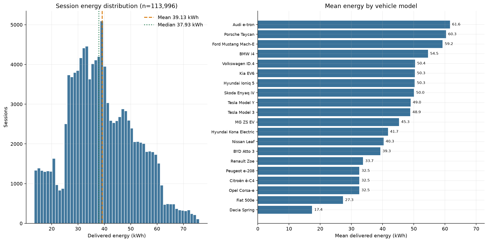
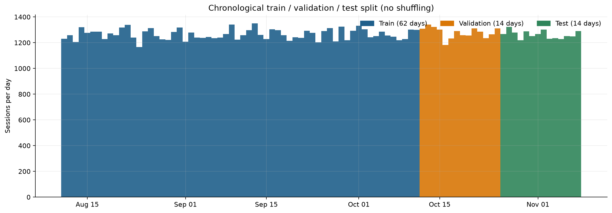
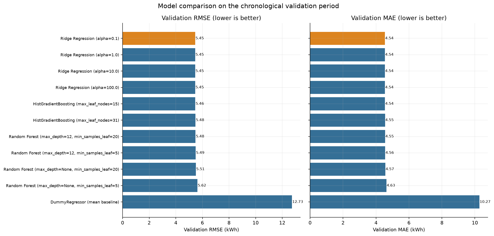
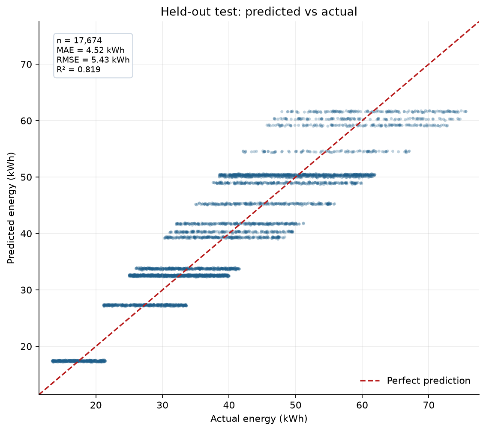
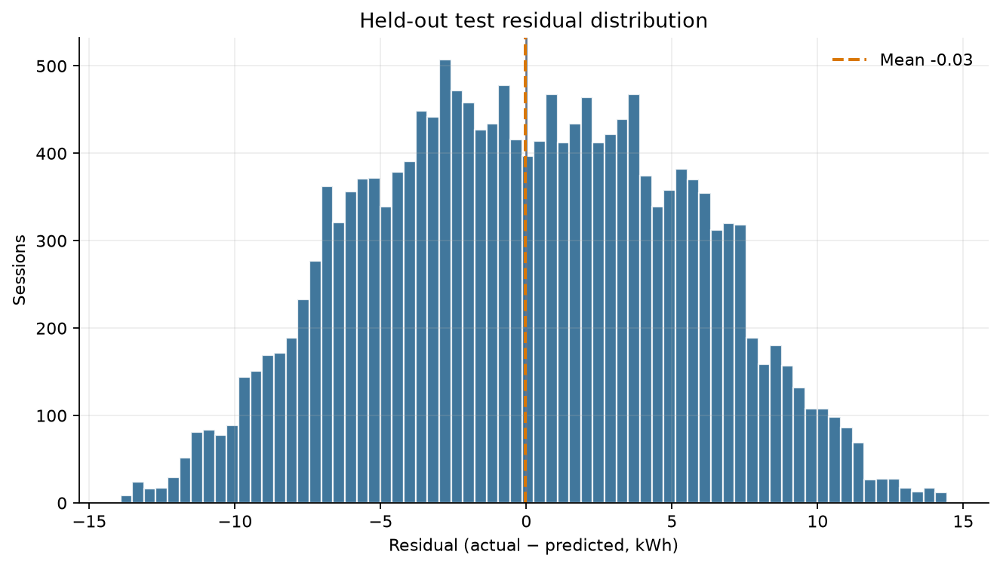
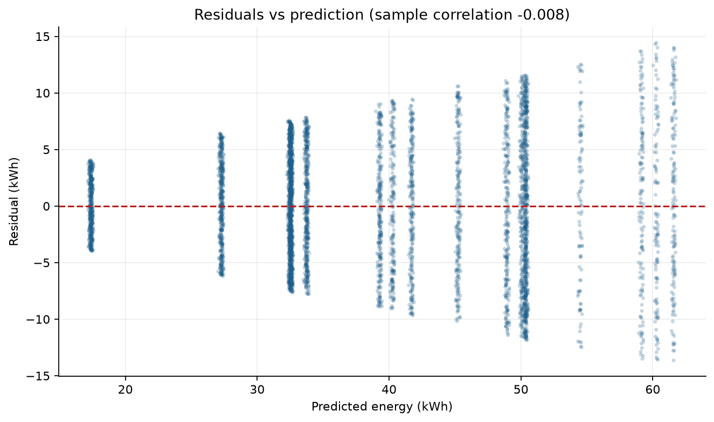
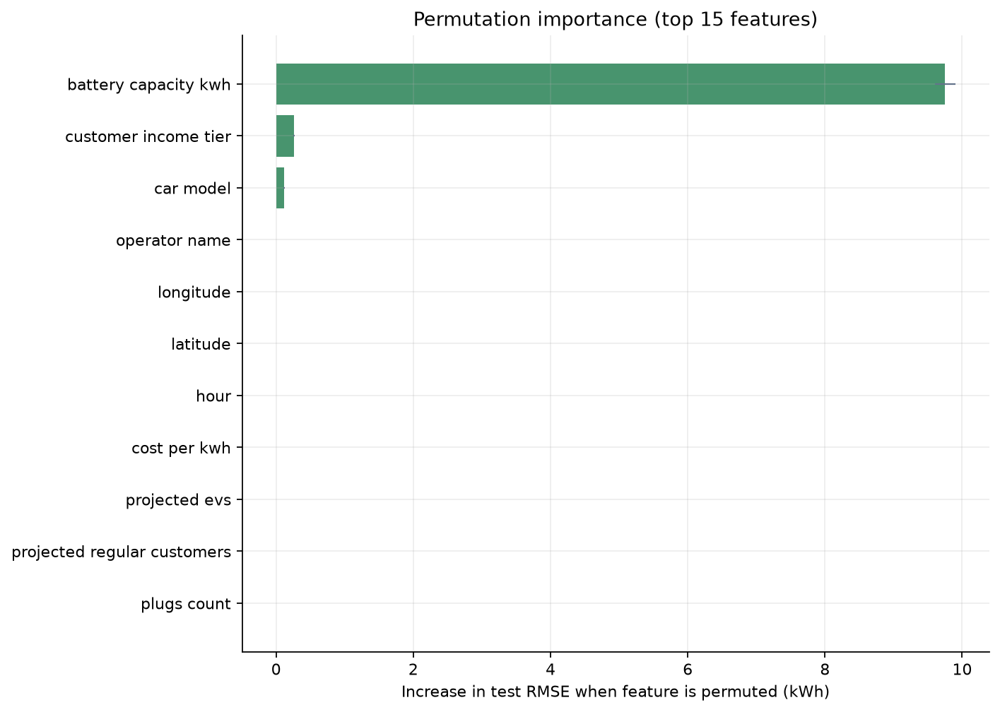
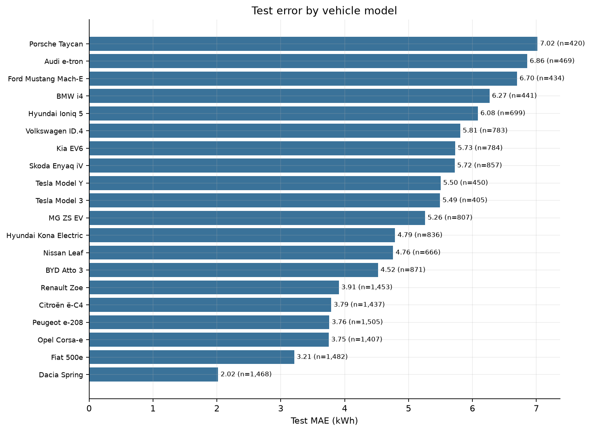
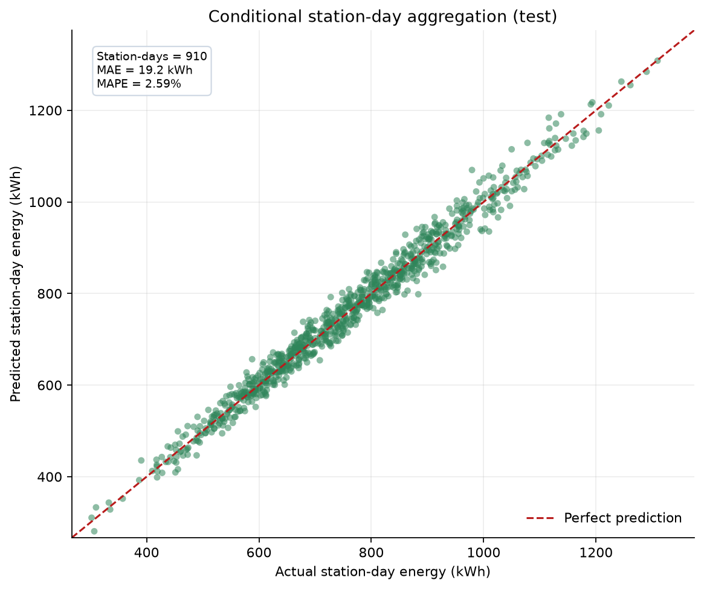

# Warsaw EV Charging — Session Energy Prediction

**Model evaluation report**

Generated: 2026-10-19T18:28:48+00:00 | Target: `kwh_charged` (kWh) | Selected model: Ridge Regression (alpha=0.1)

> **Report basis.** Metrics in this report come from the executed pipeline on the configured dataset. The test period is chronological and was not used for model selection. Methodological explanations and recommendations are clearly separate from actual scores.

## Contents

- [1. Executive summary](#1-executive-summary)
- [2. Project overview and business objective](#2-project-overview-and-business-objective)
- [3. Dataset files, dimensions and columns](#3-dataset-files-dimensions-and-columns)
- [4. Data quality findings](#4-data-quality-findings)
- [5. Prediction target and justification](#5-prediction-target-and-justification)
- [6. Preprocessing methodology](#6-preprocessing-methodology)
- [7. Feature engineering decisions](#7-feature-engineering-decisions)
- [8. Train, validation and test split](#8-train-validation-and-test-split)
- [9. Models evaluated and selection](#9-models-evaluated-and-selection)
- [10. Held-out test evaluation](#10-held-out-test-evaluation)
- [11. Residual and segment analysis](#11-residual-and-segment-analysis)
- [12. Evaluation visualizations](#12-evaluation-visualizations)
- [13. Interpretation of important features](#13-interpretation-of-important-features)
- [14. Business implications for Warsaw EV charging](#14-business-implications-for-warsaw-ev-charging)
- [15. Model limitations and risks](#15-model-limitations-and-risks)
- [16. Reproducibility instructions](#16-reproducibility-instructions)
- [17. Conclusion and recommendations](#17-conclusion-and-recommendations)
- [18. Appendix](#18-appendix)

## 1. Executive summary

> **Actual held-out test result**
>
> **Ridge Regression (alpha=0.1)** achieved MAE **4.518 kWh**, RMSE **5.426 kWh**, R² **0.8187**, and MAPE **11.89%** on 17,674 sessions from 2025-10-26 to 2025-11-08. The dummy-mean test RMSE was **12.746 kWh**.

The model predicts the energy delivered in one EV charging session in Warsaw. The test period is strictly after the validation period, and the model configuration was selected on validation data before the test set was evaluated.

The selected model reduced held-out RMSE by **57.43%** and MAE by **56.24%** versus the dummy mean baseline. The ML model is statistically indistinguishable from the transparent one-feature battery-capacity heuristic (RMSE change -0.00%). The current feature set therefore adds no measurable accuracy beyond vehicle battery capacity.

Permutation importance ranks battery_capacity_kwh, customer_income_tier, car_model, operator_name, longitude as the most influential inputs. That result is consistent with the observed target structure: delivered energy is tightly tied to vehicle battery capacity, while time, station and district attributes add little in this sample.

All 114,000 source sessions were inspected; 113,996 usable sessions entered modeling. The dataset covers only three months in one city, and the energy-to-battery ratio is bounded between roughly 0.50 and 0.80. Those facts materially limit real-world claims.

## 2. Project overview and business objective

### Business problem

Charging-network planners need an estimate of how much energy a session will deliver so they can size capacity, plan energy procurement, prioritize high-demand vehicle segments, and set realistic expectations for station-level demand. This project builds a reproducible benchmark for that estimate using the available session, customer, station and district data.

### Prediction task

**Selected prediction task**

| Item | Definition |
| --- | --- |
| Target | kwh_charged — delivered energy per charging session |
| Unit | kilowatt-hours (kWh) |
| Unit of prediction | One charging session |
| Task type | Supervised regression |
| Prediction time | When the customer, vehicle, station, tariff and session start time are known |
| Features | Vehicle, customer tier, station, district planning attributes, tariff, calendar/cyclical time |
| Excluded | session_id, customer_id, station_id, raw timestamp, total_cost (target-derived) |
| Split | Chronological train / validation / held-out test by whole calendar days |

### Expected business value

The model gives an expected energy estimate per session and a transparent way to aggregate expected energy to station-day or district-day totals when the arriving session mix is known. That supports scenario planning and vehicle-mix analysis. It does not forecast how many vehicles will arrive, and it does not establish causal effects of station location, operator or time.

### Scope and limitations up front

The available files contain no session duration, no arrival/departure state of charge, no occupancy or queue data, and no weather, traffic or event data. The observation window is short. The energy target also has a strikingly regular relationship to battery capacity. These issues are documented in the limitations section and should be addressed before operational deployment.

## 3. Dataset files, dimensions and columns

### Files inspected and selected

All four CSV files found in the configured dataset directory were inspected. All four are used for modeling: sessions supply the target, customers and stations supply join attributes, and districts supply static planning features. The source files were read with UTF-8 BOM support and were not modified.

**Source files**

| File | Rows | Columns | Missing cells | Duplicate rows | Size |
| --- | --- | --- | --- | --- | --- |
| charging_sessions.csv | 114,000 | 7 | 0 | 0 | 10.44 MB |
| charging_stations.csv | 65 | 7 | 0 | 0 | 0.00 MB |
| customers.csv | 8,000 | 4 | 0 | 0 | 0.26 MB |
| districts.csv | 18 | 5 | 0 | 0 | 0.00 MB |

### Dataset dimensions

**Data volume**

| Measure | Value |
| --- | --- |
| Raw charging sessions | 114,000 |
| Usable modeling sessions | 113,996 |
| Customers | 8,000 |
| Stations | 65 |
| Districts in reference file | 18 |
| Districts represented in sessions | 13 |
| Observation window | 2025-08-11 to 2025-11-08 |
| Window length | 89 days |

### Relationships between files

charging_sessions.customer_id joins to customers.customer_id; charging_sessions.station_id joins to charging_stations.station_id; and charging_stations.district_name joins to districts.district_name. Every session customer and station matched the reference tables in the inspected data. The session files are transaction-level records, not station-level aggregates.

### Relevant column descriptions

**Column dictionary**

| File | Column | Description |
| --- | --- | --- |
| charging_sessions.csv | session_id | Unique session identifier (excluded from model features). |
| charging_sessions.csv | customer_id | Foreign key to customers.csv (excluded from model features). |
| charging_sessions.csv | station_id | Foreign key to charging_stations.csv (excluded from model features). |
| charging_sessions.csv | session_start_time | Session start timestamp, parsed to hour/day-of-week features; raw timestamp excluded. |
| charging_sessions.csv | kwh_charged | Energy delivered in kWh — the prediction target. |
| charging_sessions.csv | cost_per_kwh | Tariff at session start in PLN/kWh; known before/at session start and used as a feature. |
| charging_sessions.csv | total_cost | Billing total; equals kWh × tariff, so it is target-derived and excluded. |
| charging_stations.csv | station_id | Station identifier; used for joins only. |
| charging_stations.csv | district_name | Warsaw district of the station. |
| charging_stations.csv | income_tier | Station/district income tier used as a categorical feature. |
| charging_stations.csv | operator_name | Charging operator name. |
| charging_stations.csv | plugs_count | Number of plugs at the station (constant in this dataset). |
| charging_stations.csv | latitude | Station latitude. |
| charging_stations.csv | longitude | Station longitude. |
| customers.csv | customer_id | Customer identifier; used for joins only. |
| customers.csv | income_tier | Customer income tier. |
| customers.csv | car_model | Electric vehicle model. |
| customers.csv | battery_capacity_kwh | Vehicle battery capacity in kWh. |
| districts.csv | district_name | District name (join key). |
| districts.csv | income_tier | District income tier (duplicates station tier). |
| districts.csv | projected_evs | District-level projected EV population (static planning data). |
| districts.csv | projected_plugs | District-level projected plug count. |
| districts.csv | projected_regular_customers | District-level projected regular customer count. |

There are 8,000 distinct customers, 65 stations and 13 districts represented in the modeling rows. Every customer appears repeatedly, which is why identifier columns were excluded and the evaluation uses a chronological split rather than a random row shuffle.

## 4. Data quality findings

The source window is 2025-08-11 to 2025-11-08 (89 days). The raw sessions table has no missing cells in the inspected data. Data-quality checks still removed contradictory or unusable records as documented below.

**Data-quality checks and treatments**

| Check | Result |
| --- | --- |
| Raw session rows | 114,000 |
| Invalid / missing start timestamps | 0 |
| Missing customer or station identifiers | 0 |
| Exact duplicate rows removed | 0 |
| Duplicate session IDs removed | 0 |
| Repeated customer + start-minute sessions removed | 4 |
| Missing / non-positive target rows removed | 0 |
| Same station + start-minute rows (retained; multiple plugs) | 1,841 |
| Target physical range | 13.40 to 76.00 kWh |
| Target mean / median | 39.13 / 37.93 kWh |
| IQR outlier flags (retained) | 96 |
| Energy / battery-capacity range | 0.5000 to 0.8000 |
| Sessions above battery capacity | 0 |
| Invalid tariff rows (set to missing) | 0 |
| Invalid battery-capacity rows | 0 |
| Invalid coordinate rows | 0 |
| Cost identity max abs error | 8.53e-14 |
| Customer session coverage | 113,996 matched / 0 unmatched |
| Station session coverage | 113,996 matched / 0 unmatched |
| Missing feature values in final frame | 0 |

### Duplicates

4 repeated customer/start-minute pairs were removed because one customer cannot begin two sessions at two stations in the same minute. 1,841 rows share a station and start minute; these were retained because a station with six plugs can legitimately start multiple sessions in the same minute.

### Missing values

No missing values were present in the source columns used for modeling. The trained preprocessing pipeline nevertheless includes median imputation for numeric features and most-frequent imputation for categorical features, fitted on training data only. This keeps inference robust to future incomplete records.

### Outliers and physical plausibility

The target ranges from 13.40 to 76.00 kWh. The IQR rule flags 96 sessions, but none were removed: every value is physically plausible and the extremes are genuine large-battery sessions. The ratio of delivered energy to battery capacity ranges from 0.5000 to 0.8000, and no session exceeds the customer's battery capacity.

> **Important data-generating pattern**
>
> The target is almost exactly bounded between 50% and 80% of battery capacity, and every vehicle model has a mean ratio near 0.65. This is characteristic of a simulated or highly standardized process, not of unrestricted real-world charging. The model can recover the vehicle-capacity relationship, but the data do not reveal the operational drivers that would matter in production.

The maximum absolute discrepancy in the billing identity (total_cost − kWh × tariff) was 8.53e-14, consistent with floating-point rounding. total_cost was nevertheless excluded from the features because it is target-derived.

## 5. Prediction target and justification

The primary target is **kwh_charged**, the energy delivered in a charging session. It is directly observed at transaction level, has 114,000 candidate records, is continuous and non-negative, and supports a clear operational question: how much energy should a session of this vehicle/customer/station/time profile be expected to draw?

**Candidate prediction tasks**

| Candidate task | Support in this dataset | Decision |
| --- | --- | --- |
| Session energy consumption | Direct target; 114k sessions; vehicle and station attributes available at session start. | Selected |
| Session duration | No end time or duration column exists. | Not feasible without additional data |
| Session revenue | total_cost = kWh × tariff; it is a deterministic transform of the energy target. The tariff is not a modelled business outcome. | Not selected as a separate target |
| Station utilization | Only session starts are available; no plug occupancy, queue or capacity-over-time data. | Only weakly approximable; future work |
| Future demand forecast | 89 days of history; arrivals are not explained by available exogenous data, and no lag/forecast infrastructure would be reliable yet. | Deferred; requires a longer series and arrival data |

### Prediction-time information

At session start the operator can know the customer account and vehicle, the selected station and its district, the tariff, and the timestamp. The model uses those inputs. It does not use the realized kWh, billing total, session identifier, customer identifier or station identifier.

### Why this is a regression problem

The target is continuous and measured in kWh, so the problem is supervised regression. The evaluation therefore reports MAE, RMSE, R² and MAPE, with residual and segment analysis. Classification metrics and decision thresholds do not apply.

## 6. Preprocessing methodology

- Loaded each CSV with UTF-8 BOM support; validated required column schemas and row counts; preserved the sources.
- Parsed session_start_time with coercion and removed records with unusable timestamps or missing customer/station identifiers.
- Coerced energy, tariff, battery, coordinate and projection columns to numeric values; set impossible tariffs/coordinates to missing rather than silently using them.
- Removed exact duplicate rows, duplicate session IDs, and contradictory repeated customer/start-minute sessions.
- Dropped only missing or non-positive target rows; retained plausible high-energy outliers after physical plausibility checks.
- Joined customer, station and district reference tables with many-to-one validation; inspected unmatched records.
- Separated the target from inputs and asserted that target, identifiers and billing total are not in the feature list.

**Learned transformations**

| Pipeline stage | Learned on | Applied to | Purpose |
| --- | --- | --- | --- |
| Numeric median imputation | Training rows only | Validation / test / new data | Handle missing numeric inputs |
| Categorical most-frequent imputation | Training rows only | Validation / test / new data | Handle missing categories |
| StandardScaler | Training rows only | Validation / test / new data | Scale numeric inputs for Ridge |
| OneHotEncoder(handle_unknown='ignore') | Training rows only | Validation / test / new data | Encode categories; unseen categories become zero-vector |
| Ridge / RandomForest / HistGradientBoosting | Training rows only; final refit train+validation | Validation / test | Prediction |

All learned transformations are inside a scikit-learn Pipeline saved with the estimator. No imputer, scaler, encoder or model was fitted on the test set. For model selection, each candidate pipeline was fitted on the training partition only. After selection, the chosen pipeline was refitted on train+validation, and the test set was transformed but never fitted.

### Leakage prevention

total_cost is a deterministic product of the target and tariff and was excluded. Identifiers were excluded so the model cannot memorize a session, customer or station. The raw timestamp was replaced with calendar fields. The split is chronological, so future sessions cannot inform predictions of earlier sessions. The final model is saved together with its metadata, feature list, preprocessing pipeline and data fingerprint.

## 7. Feature engineering decisions

Features were chosen so that they would be available at session start and so that they describe the vehicle, customer segment, station context, static district planning context and time of day. The engineered features are deterministic row-wise transforms, not target encodings.

**Model features**

| Feature | Type | Description |
| --- | --- | --- |
| battery_capacity_kwh | Numeric | Vehicle battery capacity (kWh) from customers.csv. |
| cost_per_kwh | Numeric | Session tariff (PLN/kWh), known at prediction time. |
| plugs_count | Numeric | Station plug count (constant at 6 in this sample). |
| latitude | Numeric | Station latitude. |
| longitude | Numeric | Station longitude. |
| projected_evs | Numeric | District projected EV population. |
| projected_plugs | Numeric | District projected plug count. |
| projected_regular_customers | Numeric | District projected regular customers. |
| evs_per_projected_plug | Numeric | District projected EVs divided by projected plugs. |
| hour | Numeric | Hour of session start (0–23). |
| day_of_week | Numeric | Day of week (0 = Monday). |
| is_weekend | Numeric | 1 for Saturday/Sunday, else 0. |
| hour_sin | Numeric | Cyclical encoding of hour (sine). |
| hour_cos | Numeric | Cyclical encoding of hour (cosine). |
| dow_sin | Numeric | Cyclical encoding of day of week (sine). |
| dow_cos | Numeric | Cyclical encoding of day of week (cosine). |
| customer_income_tier | Categorical | Customer income tier category. |
| car_model | Categorical | Vehicle model category. |
| station_income_tier | Categorical | Station/district income tier category. |
| operator_name | Categorical | Charging operator category. |
| district_name | Categorical | Warsaw district category. |

### Excluded columns

- kwh_charged — the target.
- total_cost — target-derived (kWh × tariff).
- session_id, customer_id, station_id — identifiers; excluded to prevent memorization and to allow cold-start style prediction.
- session_start_time raw timestamp — replaced with hour/day-of-week/cyclical features.
- month — excluded because the chronological test period is an unseen month and three months cannot support stable seasonal extrapolation.

After joining and engineering, the final frame contains 0 missing feature values. The pipeline still handles missing values for inference. The tariff is included because it is known at session start, but its permutation importance is reported rather than assumed to be causal.

## 8. Train, validation and test split

Sessions are split chronologically by whole calendar days: the earliest days form the training set, the next days form the validation set, and the latest days form the held-out test set. No random shuffling is used, because a future session must not inform a model that predicts the past and because the deployment scenario is future prediction.

**Chronological split**

| Period | Start | End | Days | Sessions | Share of rows |
| --- | --- | --- | --- | --- | --- |
| Train | 2025-08-11 | 2025-10-11 | 62 | 78,424 | 68.8% |
| Validation | 2025-10-12 | 2025-10-25 | 14 | 17,898 | 15.7% |
| Test (held out) | 2025-10-26 | 2025-11-08 | 14 | 17,674 | 15.5% |

Training uses 78,424 sessions; validation uses 17,898; the test period contains 17,674 sessions from 2025-10-26 to 2025-11-08. The test set was not used to choose features, hyperparameters or the final model.

### Repeated customers and grouping

Each customer contributes several sessions across the window. A random split could place the same customer's sessions in both train and test, but the model does not use a customer identifier or customer-specific target encoding, so there is no learned customer memory. The chronological split answers a deployment-relevant question: how well does a model trained on earlier sessions predict later sessions from the same population? A future sensitivity analysis could also use GroupShuffleSplit by customer, but that would answer a different cold-customer question and reduce training data.

## 9. Models evaluated and selection

A dummy mean regressor establishes the minimum baseline. Ridge Regression provides an interpretable linear benchmark. Random Forest and HistGradientBoosting test nonlinear and interaction-capable alternatives. A transparent battery-capacity heuristic is also reported as a domain benchmark. It is not eligible for selection because it is a one-feature reference rather than a maintained model pipeline, but it is the most useful comparison for deciding whether the ML features add accuracy. The ML pipeline is retained as the deliverable and as the extension point for future features, and the benchmark result is reported honestly.

**Validation comparison (model selection data)**

| Model / configuration | Validation MAE | Validation RMSE | Validation R² | Validation MAPE | Fit seconds | Selected |
| --- | --- | --- | --- | --- | --- | --- |
| Ridge Regression (alpha=0.1) | 4.537 | 5.453 | 0.8164 | 11.90% | 0.2 | Selected |
| Ridge Regression (alpha=1.0) | 4.537 | 5.453 | 0.8164 | 11.90% | 0.2 |  |
| Ridge Regression (alpha=10.0) | 4.537 | 5.453 | 0.8164 | 11.90% | 0.3 |  |
| Ridge Regression (alpha=100.0) | 4.538 | 5.453 | 0.8164 | 11.90% | 0.4 |  |
| HistGradientBoosting (max_leaf_nodes=15) | 4.541 | 5.462 | 0.8158 | 11.90% | 2.6 |  |
| HistGradientBoosting (max_leaf_nodes=31) | 4.547 | 5.476 | 0.8149 | 11.92% | 3.3 |  |
| Random Forest (max_depth=12, min_samples_leaf=20) | 4.551 | 5.479 | 0.8146 | 11.93% | 23.9 |  |
| Random Forest (max_depth=12, min_samples_leaf=5) | 4.558 | 5.490 | 0.8139 | 11.95% | 20.6 |  |
| Random Forest (max_depth=None, min_samples_leaf=20) | 4.566 | 5.505 | 0.8129 | 11.97% | 27.4 |  |
| Random Forest (max_depth=None, min_samples_leaf=5) | 4.630 | 5.620 | 0.8050 | 12.13% | 29.0 |  |
| DummyRegressor (mean baseline) | 10.272 | 12.727 | -0.0000 | 31.52% | 0.2 |  |
| Capacity heuristic (reference, not selected) | 4.535 | 5.450 | 0.8166 | 11.89% | n/a |  |

The selection criterion was minimum validation RMSE, with MAE and model complexity as tie-breakers. The selected configuration was **Ridge Regression (alpha=0.1)** with parameters alpha=0.1. Selection used validation data only; the test period was evaluated once afterwards.

After selection, the chosen pipeline was refitted on train+validation (96,322 rows). This uses all pre-test information while keeping the test set untouched. The fitted preprocessing transformer is saved inside the same artifact as the estimator.

**Selected configuration**

| Selected hyperparameter | Value |
| --- | --- |
| alpha | 0.1 |

Random seeds are fixed at 42 for splitting, tree fitting, permutation importance and bootstrap resampling. Random Forest uses 300 trees. HistGradientBoosting uses 300 iterations, a 0.05 learning rate, and no early stopping so that the run is deterministic. The search spaces were deliberately small rather than exhaustive.

## 10. Held-out test evaluation

> **Actual test metrics**
>
> Evaluated on 17,674 chronological holdout sessions (2025-10-26 to 2025-11-08). The selected model is Ridge Regression (alpha=0.1).

**Final test comparison**

| Model | n | MAE (kWh) | RMSE (kWh) | R² | MAPE |
| --- | --- | --- | --- | --- | --- |
| Selected model | 17,674 | 4.518 | 5.426 | 0.8187 | 11.89% |
| Dummy mean baseline | 17,674 | 10.324 | 12.746 | -0.0000 | 31.86% |
| Capacity heuristic (reference) | 17,674 | 4.518 | 5.426 | 0.8187 | 11.89% |

The selected model reduced held-out RMSE by **57.43%** and MAE by **56.24%** versus the dummy mean baseline. The ML model is statistically indistinguishable from the transparent one-feature battery-capacity heuristic (RMSE change -0.00%). The current feature set therefore adds no measurable accuracy beyond vehicle battery capacity.

### How to read the metrics

- MAE is the average absolute prediction error in kWh. It is directly interpretable in the target's units.
- RMSE is the square root of mean squared error; it penalizes large misses more strongly than MAE.
- R² compares squared error with a mean-only predictor. It describes variance explained in this sample, not causal importance.
- MAPE is the mean absolute percentage error. It is valid here because every actual test value is above zero, but it can be dominated by low-energy sessions; it is reported alongside absolute errors.

Mean actual test energy was 39.110 kWh and mean prediction was 39.135 kWh. The aggregate prediction error over the test period was 0.06% of actual energy. A small aggregate bias can hide large offsetting session-level errors, so the residual and segment tables below are essential.

### Bootstrap uncertainty

**Percentile bootstrap confidence intervals**

| Metric | Point estimate | 95% CI lower | 95% CI upper | Bootstrap samples |
| --- | --- | --- | --- | --- |
| RMSE (kWh) | 5.426 | 5.377 | 5.474 | 400 |
| MAE (kWh) | 4.518 | 4.471 | 4.560 | 400 |
| R² | 0.8187 | 0.8145 | 0.8225 | 400 |

The intervals quantify sampling uncertainty of the test metrics, not uncertainty for a single future session. They are relatively narrow because the test set contains 17,674 sessions.

### Evaluation integrity

Data fingerprint match: True; split match: True; data change allowed: False. A true/true/false result means the frozen model was evaluated on the same data and split used for training. Model selection was based on validation results, never on these test scores.

## 11. Residual and segment analysis

Residuals are actual minus predicted energy. A mean near zero indicates little global bias; the spread shows the irreducible session-level uncertainty. The 5th–95th percentile range is a practical description of typical error magnitude, though it is not a formal prediction interval.

**Test residuals**

| Residual statistic | Value |
| --- | --- |
| Mean residual (actual − predicted) | -0.025 kWh |
| Median residual | -0.108 kWh |
| Residual standard deviation | 5.427 kWh |
| 5th percentile | -8.813 kWh |
| 95th percentile | 8.811 kWh |
| Correlation(prediction, residual) | 0.0040 |

Residual standard deviation is expected to increase with battery size: a 50–80% state-of-charge window is wider in kWh for a large battery. The segment table therefore reports both absolute and percentage errors by vehicle model.

**Test performance by vehicle model**

| Vehicle model | n | MAE (kWh) | RMSE (kWh) | MAPE |
| --- | --- | --- | --- | --- |
| Peugeot e-208 | 1,505 | 3.758 | 4.342 | 11.88% |
| Fiat 500e | 1,482 | 3.209 | 3.697 | 12.07% |
| Dacia Spring | 1,468 | 2.018 | 2.333 | 11.92% |
| Renault Zoe | 1,453 | 3.908 | 4.508 | 11.93% |
| Citroën ë-C4 | 1,437 | 3.788 | 4.337 | 12.00% |
| Opel Corsa-e | 1,407 | 3.750 | 4.338 | 11.89% |
| BYD Atto 3 | 871 | 4.522 | 5.236 | 11.89% |
| Skoda Enyaq iV | 857 | 5.721 | 6.645 | 11.76% |
| Hyundai Kona Electric | 836 | 4.788 | 5.529 | 11.86% |
| MG ZS EV | 807 | 5.258 | 6.055 | 11.89% |
| Kia EV6 | 784 | 5.731 | 6.637 | 11.76% |
| Volkswagen ID.4 | 783 | 5.808 | 6.702 | 11.91% |
| Hyundai Ioniq 5 | 699 | 6.085 | 6.887 | 12.48% |
| Nissan Leaf | 666 | 4.758 | 5.429 | 12.05% |
| Audi e-tron | 469 | 6.857 | 7.965 | 11.39% |
| Tesla Model Y | 450 | 5.501 | 6.370 | 11.47% |
| BMW i4 | 441 | 6.266 | 7.238 | 11.75% |
| Ford Mustang Mach-E | 434 | 6.697 | 7.777 | 11.49% |
| Porsche Taycan | 420 | 7.019 | 8.132 | 11.89% |
| Tesla Model 3 | 405 | 5.491 | 6.339 | 11.53% |

**Test performance by customer tier**

| Customer income tier | n | MAE (kWh) | RMSE (kWh) | MAPE |
| --- | --- | --- | --- | --- |
| Low-Mid | 8,752 | 3.402 | 3.995 | 11.95% |
| Mid-Range | 6,303 | 5.323 | 6.162 | 11.94% |
| High | 2,619 | 6.313 | 7.348 | 11.58% |

### Conditional station-day aggregation

Session predictions were summed to station-day and district-day totals on the test set. This is a conditional aggregation: it assumes the future set of sessions is known. It is not a demand-arrival forecast. Its value is to show how much session-level noise cancels when planning energy for a known operating day.

**Aggregated test errors**

| Aggregation | Groups | MAE (kWh) | RMSE (kWh) | MAPE | R² | Dummy baseline MAPE |
| --- | --- | --- | --- | --- | --- | --- |
| Station-day (conditional) | 910 | 19.2 | 24.0 | 2.59% | 0.9810 | 6.34 |
| District-day (conditional) | 182 | 38.0 | 51.1 | 1.17% | 0.9996 | 2.85 |

Station-day aggregation has MAPE 2.59% and MAE 19.2 kWh. If the session mix is known, this is materially more useful for energy planning than a single-session error, but it must not be presented as a forecast of arrivals or utilization.

## 12. Evaluation visualizations

The figures below are generated directly from the executed pipeline. They show the target structure, the chronological split, validation model comparison, held-out fit, residuals, permutation importance, vehicle-segment error, and conditional station-day aggregation.



*Observed session energy and mean energy by vehicle model. Vehicle capacity is the dominant observable driver.*



*Daily session volume with the chronological train/validation/test boundaries.*



*Validation comparison of all candidate configurations. Orange marks the selected model.*



*Predicted versus actual session energy on a random sample of the held-out test period.*



*Test residuals. The spread reflects unobserved session-level state of charge.*



*Residuals against predictions; a near-zero correlation indicates no simple systematic bias by predicted level.*



*Permutation importance on up to 4,000 held-out sessions (5 repeats). Association, not causation.*



*Absolute test error by vehicle model. Larger batteries tend to have larger absolute errors.*



*Session predictions summed to station-days. This assumes the future session set is known; it is not a demand-arrival forecast.*

## 13. Interpretation of important features

Permutation importance measures how much test RMSE increases when one feature is randomly shuffled while the rest of the row remains unchanged. It is model-agnostic but not causal. Correlated features such as battery capacity and vehicle model can split their apparent importance.

**Top permutation importances (held-out sample)**

| Rank | Feature | Mean RMSE increase (kWh) | Std. across repeats |
| --- | --- | --- | --- |
| 1 | battery_capacity_kwh | 9.7519 | 0.1496 |
| 2 | customer_income_tier | 0.2643 | 0.0110 |
| 3 | car_model | 0.1180 | 0.0081 |
| 4 | operator_name | 0.0011 | 0.0013 |
| 5 | longitude | 0.0008 | 0.0005 |
| 6 | latitude | 0.0005 | 0.0004 |
| 7 | hour | 0.0002 | 0.0006 |
| 8 | cost_per_kwh | 0.0001 | 0.0004 |
| 9 | projected_evs | 0.0000 | 0.0000 |
| 10 | projected_regular_customers | 0.0000 | 0.0000 |
| 11 | plugs_count | 0.0000 | 0.0000 |
| 12 | projected_plugs | -0.0000 | 0.0000 |
| 13 | hour_cos | -0.0000 | 0.0001 |
| 14 | hour_sin | -0.0000 | 0.0001 |
| 15 | dow_sin | -0.0001 | 0.0001 |

The leading features are battery_capacity_kwh, customer_income_tier, car_model, operator_name, longitude. A large positive value means the model relies on that information for prediction. A value near zero or negative means shuffling it did not worsen test RMSE materially; such a feature may be redundant, noisy, or simply not associated with energy in this sample.

The strong vehicle-capacity signal should not be interpreted as evidence that station location, operator or time of day cause higher consumption. The data do not contain the operational variables needed for causal claims, and the observed target distribution is unusually regular.

## 14. Business implications for Warsaw EV charging

On the held-out period, the model predicted 691,678.1 kWh against 691,232.3 kWh actual, an aggregate error of 0.06%. That aggregate closeness is encouraging for portfolio-level energy estimates, but individual sessions still carry substantial kWh uncertainty.

Conditional station-day aggregation had MAE 19.2 kWh and MAPE 2.59% across 910 station-days. This is the most defensible operational use of the current model: scenario planning when the future session mix is known or separately forecast. It is not a utilization forecast.

### What management can reasonably do

- Use expected session energy, together with a separately forecast session count, to estimate daily energy needs by station and district.
- Use vehicle-model and customer-tier segment estimates to plan capacity for high-energy vehicles and to design tariff or charging-speed propositions.
- Treat the error bands as planning uncertainty rather than guaranteed per-session accuracy; avoid customer-facing guarantees from this model.
- Invest first in data collection: arrival/departure state of charge, session duration, occupancy, queues, weather, traffic and events. Those variables are more likely to improve operational forecasts than further tuning on the current columns.
- Monitor drift and retrain after adding new periods, operators, stations or vehicle models. Unknown categories are safely ignored by the encoder but may reduce accuracy.

### Revenue and ROI caution

The dataset contains a tariff and a billing total, but revenue, margin, utilization, electricity procurement cost and capital expenditure are not modelled here. Multiplying predicted kWh by the observed tariff gives an expected billed-energy value, not profit or ROI. No expansion, profitability or return-on-investment conclusion should be drawn from these predictions.

### Association is not causation

The model identifies associations useful for prediction. It does not show that changing a station's operator, district or opening time would change energy demand. Causal questions require designed comparisons or experiments, not this observational model.

## 15. Model limitations and risks

- The target is almost perfectly bounded between 50% and 80% of battery capacity, with a mean ratio near 0.65 for every vehicle model. This suggests simulated or highly standardized data. High R² mostly reflects battery size, not operational behavior.
- The observation window is only 89 days (August–November 2025) in one city. Seasonality, holidays, long-term trends and network changes are not represented.
- There is no session duration, end time, arrival/departure state of charge, charging power, queue, occupancy or plug-availability data.
- There are no weather, traffic, event, competitor or local economic variables.
- Repeated customer sessions are handled with a chronological split and no customer identifiers, but only one 15% time-based holdout is available; metric uncertainty is quantified with a bootstrap, not with repeated rolling-origin evaluation.
- Model selection searched a small grid on one validation period. A different period or a larger search could change the selected model.
- The model is point-prediction only. It does not produce calibrated prediction intervals; bootstrap intervals describe metric uncertainty, not individual-session uncertainty.
- Unknown categories at inference are ignored by the encoder. Cold-start stations, new operators, new vehicle models and changed tariffs may be predicted poorly.
- The data are not sufficient for causal claims, revenue/ROI claims, or a causal expansion decision.
- The artifact is tied to a dataset fingerprint. Retraining is required if source files, schema or business definitions change materially.

> **Suitability statement**
>
> This is a credible benchmark and a useful planning prototype, but it is not validated for real-time operational control, customer pricing guarantees, or capital-expansion decisions. The dominant predictor is vehicle battery capacity, and the dataset appears synthetic-like. Production use requires richer behavioral data, external validation and ongoing monitoring.

## 16. Reproducibility instructions

The pipeline is runnable on Windows with Python. The dataset directory, model directory and reports directory are configurable through CLI arguments, environment variables or configs/config.json. The default dataset location is resolved from the current user's home directory; no Windows username is hard-coded in source files.

### Setup

```text
py -m venv .venv
.venv\Scripts\Activate.ps1
python -m pip install --upgrade pip
python -m pip install -r requirements.txt
```

### Train and evaluate

```text
# Use --data-dir for a custom location; otherwise set WARSAW_EV_DATA_DIR.
python -m src.train --data-dir "C:\path\to\Warsaw EV Charging"
python -m src.evaluate --data-dir "C:\path\to\Warsaw EV Charging"
```

train.py performs schema validation, cleaning, feature engineering, the chronological split, candidate fitting and validation-based selection, then saves the refitted pipeline. evaluate.py verifies the data fingerprint, evaluates the frozen model on the test period, writes metrics/figures and regenerates both reports.

### Predict on new sessions

```text
python -m src.predict --input new_sessions.csv --data-dir "C:\path\to\Warsaw EV Charging" --output reports/new_predictions.csv
```

The inference CSV must contain customer_id, station_id, session_start_time and cost_per_kwh. session_id is optional. Customer, station and district attributes are joined from the source lookup files; unknown IDs raise an actionable error. Any kwh_charged column in the input is ignored by the model.

### Tests

```text
python -m pytest -q
```

**Generated artifacts**

| Artifact | Location |
| --- | --- |
| Trained pipeline + metadata bundle | models\best_model.joblib |
| Machine-readable metadata | models\model_metadata.json |
| Metrics payload | reports\model_metrics.json |
| Markdown report | reports\model_evaluation_report.md |
| HTML report | reports\model_evaluation_report.html |
| Figures | reports\figures |
| Row-level test predictions | reports\test_predictions.csv |

Training data fingerprint: `2a5e090ba972d96c66865353df5977a6bd7b485aa4428d6914e3304f633bfe9c`. The fingerprint is stored with the model and checked before evaluation. If the source CSVs change, retrain; if you intentionally evaluate a changed dataset, use --allow-data-change and treat the results as a new experiment rather than the frozen model's original test score.

## 17. Conclusion and recommendations

The selected model is **Ridge Regression (alpha=0.1)**. On the chronological test set it achieved MAE 4.518 kWh, RMSE 5.426 kWh, R² 0.8187 and MAPE 11.89%, compared with a dummy baseline RMSE of 12.746 kWh. The selected model reduced held-out RMSE by **57.43%** and MAE by **56.24%** versus the dummy mean baseline. The ML model is statistically indistinguishable from the transparent one-feature battery-capacity heuristic (RMSE change -0.00%). The current feature set therefore adds no measurable accuracy beyond vehicle battery capacity.

The result is strong enough to justify using the model as a session-energy planning prototype, especially for conditional station-day energy aggregation. It is not strong enough to justify real-time control, revenue guarantees, or expansion decisions without additional data and validation. The vehicle battery signal dominates; station, time and district effects are weak in this sample.

### Recommended next steps

- Collect arrival and departure state of charge, session duration, charging power and station occupancy; these are the most direct missing drivers of delivered energy.
- Extend the observation window to at least 12 months and evaluate rolling-origin forecasts across seasons.
- Build a separate arrival-count/utilization model, then combine it with this energy model for a genuine demand forecast.
- Add weather, traffic, holidays/events, local EV registrations and tariff changes as candidate features.
- Add quantile or conformal prediction intervals and monitor calibration in production.
- Run a rolling backtest and a GroupShuffleSplit-by-customer sensitivity analysis before deployment.
- If the data are confirmed to be synthetic, validate on real charging-network data before making operational decisions.

## 18. Appendix

### District-level test performance

**Test performance by district**

| District | n | MAE (kWh) | RMSE (kWh) | MAPE |
| --- | --- | --- | --- | --- |
| Ursynów | 3,300 | 4.546 | 5.460 | 11.88% |
| Wesoła | 2,928 | 4.578 | 5.487 | 12.03% |
| Wilanów | 2,186 | 4.426 | 5.332 | 11.71% |
| Włochy | 1,615 | 4.481 | 5.409 | 11.71% |
| Mokotów | 1,411 | 4.671 | 5.552 | 12.21% |
| Ochota | 1,399 | 4.493 | 5.365 | 12.01% |
| Targówek | 1,354 | 4.503 | 5.393 | 11.93% |
| Śródmieście | 793 | 4.489 | 5.381 | 11.90% |
| Żoliborz | 558 | 4.488 | 5.381 | 11.82% |
| Rembertów | 545 | 4.384 | 5.367 | 11.56% |
| Ursus | 535 | 4.450 | 5.379 | 11.85% |
| Bemowo | 525 | 4.598 | 5.551 | 11.83% |
| Wola | 525 | 4.406 | 5.330 | 11.68% |

### Operator-level test performance

**Test performance by operator**

| Operator | n | MAE (kWh) | RMSE (kWh) | MAPE |
| --- | --- | --- | --- | --- |
| Ekoenergetyka | 4,063 | 4.593 | 5.514 | 11.96% |
| GreenWay | 4,061 | 4.417 | 5.315 | 11.79% |
| Tesla | 4,031 | 4.491 | 5.400 | 11.88% |
| Orlen Charge | 3,256 | 4.520 | 5.430 | 11.83% |
| Tauron | 2,263 | 4.612 | 5.508 | 12.05% |

### Additional data profile

**Supplementary profile**

| Profile item | Value |
| --- | --- |
| Sessions per customer (mean / median) | 14.25 / 14.00 |
| Sessions per station (mean / median) | 1753.78 / 1755.00 |
| Tariff values observed | 1.851397 (33,818), 2.704520 (57,410), 3.256199 (22,768) |
| Target IQR lower / upper fence | 3.10 / 75.05 kWh |
| Task type | Regression |
| Report generated (UTC) | 2026-10-19T18:28:48+00:00 |
| Evaluation runtime | 8.9 seconds |
| Data fingerprint | 2a5e090ba972d96c66865353df5977a6bd7b485aa4428d6914e3304f633bfe9c |

This report was generated by src/reporting.py from reports/model_metrics.json. The metrics table values come from actual execution on the configured dataset. Methodological text, interpretations and recommendations are not model outputs. No score or chart in this report was hand-entered or fabricated.
